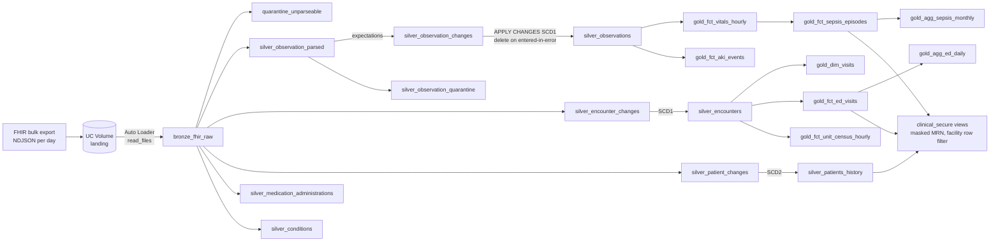

# Clinical Operations Lakehouse on Azure Databricks

A hospital operations lakehouse built on Azure Databricks, written almost entirely in SQL. It ingests FHIR R4 bulk exports from two hospitals and produces five clinical-operations outputs:

- Emergency department throughput
- Hourly bed census
- Sepsis bundle compliance
- Acute kidney injury detection
- A governed, de-identified layer for analysts

Deployment uses a Databricks Asset Bundle, which creates the Unity Catalog schemas, landing volume, Lakeflow Declarative Pipeline (formerly Delta Live Tables), and orchestration job.

All data is synthetic, produced by `generator/generate_fhir.py`. No real patients are involved. The clinical measures follow the structure of real specifications (CMS SEP-1, KDIGO) but are simplified, and are not for clinical use.

## Architecture



The pipeline runs serverless and is triggered by new files arriving in the volume. After each refresh, the job runs two SQL tasks on a SQL warehouse: one rebuilds the governed views, and one runs a quality gate that fails the job if thresholds are breached.

## What the data throws at it

The generator behaves like a real EHR interface feed:

- **Encounters are sent twice:** once when the patient arrives and again when they leave. The latest version has to win.
- **Lab results change after the fact:** they get amended, sometimes arriving out of order across daily batches, or retracted as `entered-in-error`.
- **One hospital runs a legacy interface:** it sends temperatures in °F, lactate in mg/dL, and timestamps with a local offset instead of UTC.
- **Deliveries fail in small ways:** duplicate redeliveries, impossible values (a heart rate of 900), observations missing the patient reference, and truncated JSON lines.
- **Patients move:** a new address creates a new version of the patient record.

## Running it

**Locally, no Databricks needed.** You need Python 3.11 and Java 17.

```bash
pip install -r requirements-dev.txt
make test      # 23 tests: pipeline SQL on local Spark in ANSI mode
make local     # generate 45 days of data, run everything, print the gold tables
```

**On Azure Databricks.** You need a Unity Catalog–enabled workspace, the Databricks CLI, and a SQL warehouse.

```bash
databricks auth login --host https://adb-<workspace-id>.azuredatabricks.net
databricks bundle deploy -t dev --var="warehouse_id=<id>"
make data
scripts/upload_batches.sh 1 30     # first 30 days
make run
scripts/upload_batches.sh 31 45    # the rest; Auto Loader reads only the new files
make run
```

Before the governance step can grant access, create the account groups `clinical_analysts`, `phi_full_access`, `facility_all`, `facility_atl_main` and `facility_atl_east`.

## How the local test harness works

The pipeline files use Lakeflow SQL syntax (`CREATE OR REFRESH STREAMING TABLE`, `CONSTRAINT ... EXPECT`, `APPLY CHANGES INTO`), which only runs inside Databricks. `local/dlt_local.py` executes those same files on open-source Spark.

The harness only translates the pipeline wrappers:
- Streaming tables become batch views.
- Expectations become filters, with their failure counts recorded.
- `APPLY CHANGES` becomes an equivalent window-function query.

The SELECT logic runs exactly as written. Spark runs in ANSI mode, like Databricks SQL, so a bad cast or a division by zero fails locally the same way it would in production.

The scenario tests in `tests/test_scenarios.py` hand-build patients with known correct answers. Examples:
- a septic patient whose antibiotics come 70 minutes after arrival
- an amended lab result that arrives in an earlier batch than the original it corrects
- a 100.4°F reading sent with an EDT offset

Each test asserts the exact output.

**What the tests don't cover.** The Databricks-only pieces haven't been run against a live workspace. That includes Auto Loader, the real `APPLY CHANGES` engine, the event log query, the governance SQL and the bundle YAML. The governance, monitoring and dashboard SQL parses cleanly with sqlglot's Databricks dialect. CI includes a `bundle validate` job that runs once workspace credentials are added as repo secrets.

## Design decisions

### Bronze keeps raw text; parsing happens once per resource type

Auto Loader reads the NDJSON as text, one row per line. A truncated line can't break ingestion: it lands in `quarantine_unparseable` and can be replayed. Each silver table parses its own resource type with an explicit `from_json` schema, never an inferred one.

### Versioning is handled by APPLY CHANGES, not hand-written MERGE

An observation can be sent, amended, and retracted across different daily batches, in any order. `APPLY CHANGES ... SEQUENCE BY struct(last_updated, source_file)` keeps the latest version per ID, and `APPLY AS DELETE WHEN status = 'entered-in-error'` removes retracted results.

A redelivered duplicate carries the same `lastUpdated` as the original. The source file is included in the sequence key as a deterministic tie-break, so duplicates can't be applied in an arbitrary order.

### Quality rules drop bad rows but never lose them

Expectations with `ON VIOLATION DROP ROW` keep bad rows out of silver, and their pass/fail counts go to the pipeline event log (`monitoring/expectations.sql`).

A parallel quarantine table keeps the dropped rows themselves, with a reason and the raw JSON, because the event log counts rows but doesn't store them. The job's quality gate fails the run if more than 2% of observation versions are quarantined.

### Units are normalised at the door

The legacy hospital's values are converted in silver: °F to °C, and lactate from mg/dL to mmol/L (divided by 9.01). Timestamps are normalised to UTC. Every downstream query can assume one unit per measure.

A warn-only expectation flags any unit that still isn't canonical, so a new unit variant shows up in the event log instead of silently skewing results.

### A visit spans the ED and the inpatient stay

A sepsis episode that starts in the ED and continues in the ICU is one clinical event across two FHIR encounters. `gold_encounter_visit_map` uses `Encounter.partOf` to tie them together, and every clinical measure works at the visit level.

### Sepsis needs time-aware carry-forward

Vitals are charted irregularly: every 30 minutes in the ED, every 4 hours on the floor. `gold_fct_vitals_hourly` builds a complete hour spine per visit and carries the last value forward with `last_value(..., true)`. It stores each value as a struct with its observation time, so a value older than 6 hours (24 for white blood cell count) counts as missing rather than current.

Time zero is the first hour where all three conditions hold within a 6-hour window:
- the patient meets 2+ SIRS criteria
- a blood culture was collected
- there's organ dysfunction (lactate > 2 or systolic BP < 90)

Time zero is never earlier than arrival. A fever workup without organ dysfunction counts as a rule-out, not an episode.

### Census is counted on the hour, against a full spine

Each location period is exploded into the hour marks it covers. The result is joined to a complete unit × hour spine, so an empty ICU shows as 0 instead of a missing row. Patients still in a bed are counted up to the end of the data.

### PHI stays in the pipeline schema

Analysts get `clinical_secure` views only:
- MRNs are masked unless the user is in `phi_full_access`.
- Rows are filtered to the user's facility groups.
- Ages over 89 are grouped as "90+" and ZIP codes are cut to three digits, following HIPAA Safe Harbor.

Names never leave silver. On a regular table, the same functions could be attached directly with `ALTER TABLE ... SET ROW FILTER` / `SET MASK`.

## SQL techniques, and where to find them

| Technique | File |
|---|---|
| `from_json` with nested FHIR schemas, higher-order `filter` / `transform` / `exists` | `03_silver_encounters.sql` |
| ANSI-safe parsing: `try_to_timestamp`, `try_element_at`, `try_cast`, `try_divide` | all silver files |
| Stream-static join (streaming table to a reference view) | `02_silver_observations.sql` |
| Change data capture, SCD1 with deletes and SCD2 with `TRACK HISTORY` | `02_…`, `04_silver_patients.sql` |
| Bounded carry-forward: `last_value(named_struct(...), true)` + staleness check | `13_gold_sepsis.sql` |
| Interval joins and correlated `EXISTS` on time windows | `13_gold_sepsis.sql` |
| `RANGE BETWEEN INTERVAL 48 HOURS PRECEDING` over timestamps | `14_gold_aki.sql` |
| `sequence` + `explode` to build hour spines, `LATERAL VIEW` | `12_gold_census.sql` |
| `min_by` / `max_by`, `count_if`, `FILTER`, `percentile_approx` | `10_…`, `11_gold_ed.sql` |
| Time zone handling for reporting dates (`from_utc_timestamp`) | `11_gold_ed.sql` |
| UC SQL functions for masking and row filtering, `is_account_group_member` | `governance/secure_views.sql` |
| `raise_error` as a quality gate in a job | `monitoring/quality_gate.sql` |
| Querying the pipeline event log with `:` JSON paths | `monitoring/expectations.sql` |

## Sample output (45 days, local run)

| | ATL-MAIN | ATL-EAST |
|---|---|---|
| ED arrivals / day | 44 | 29 |
| Median door-to-provider (min) | 39 | 41 |
| Left without being seen | 3.2% | 2.5% |
| Median boarding (hours) | 3.7 | 1.8 |
| Sepsis bundle compliance (June) | 24% | 35% |

ATL-MAIN's boarding times are longer by design: the generator gives it fewer inpatient beds, and the gold layer surfaces the effect.
